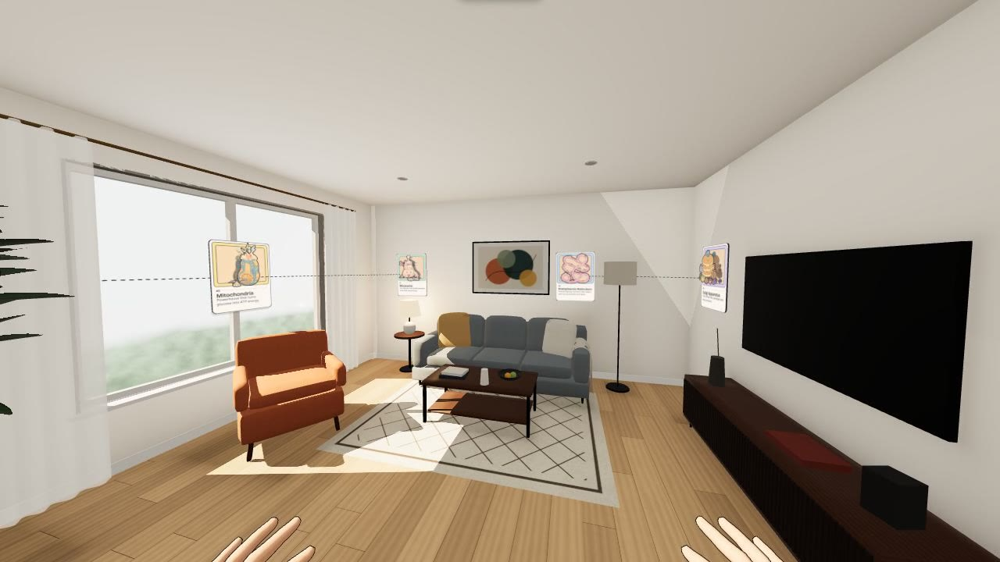
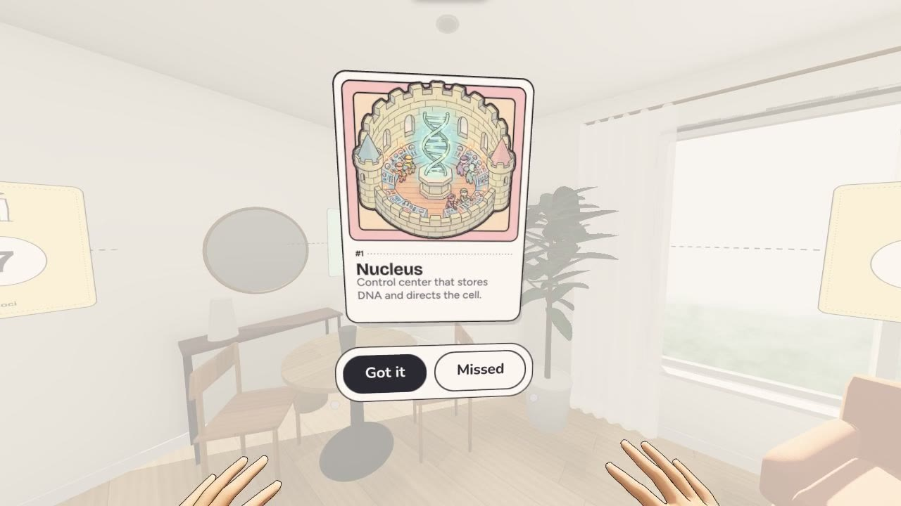
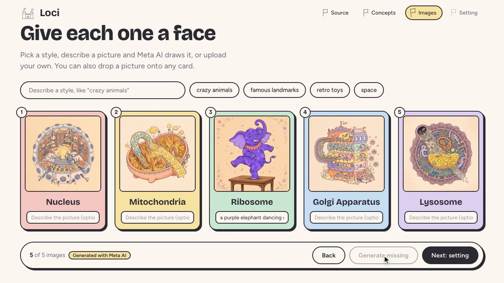
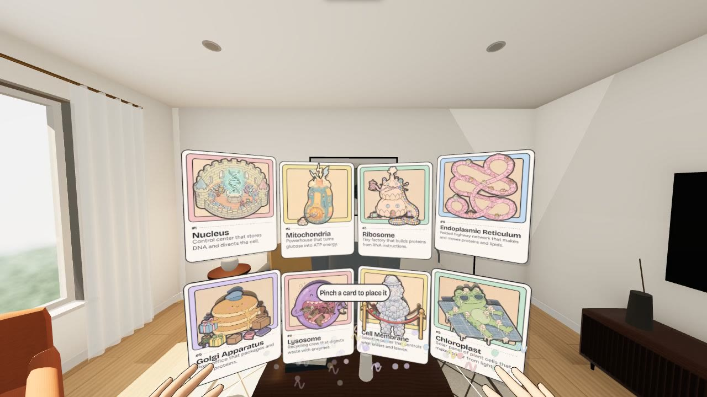
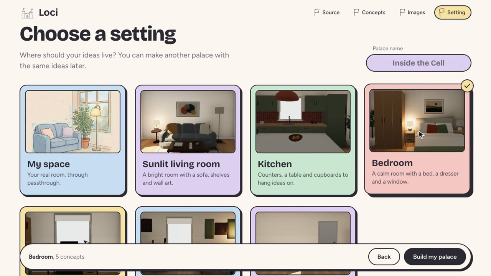
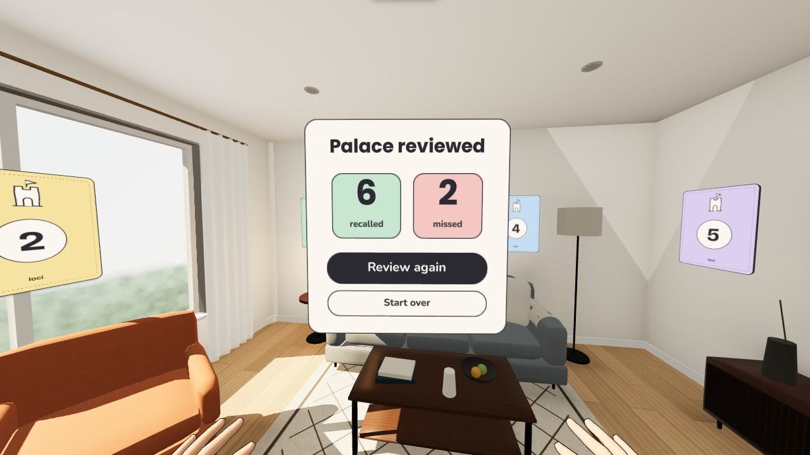

# LOCI

**A memory palace you can walk into.** Turn your notes into strange, unforgettable pictures, place them around a room in VR, and come back later to walk the path and recall them.

Built for Meta Quest with the [Immersive Web SDK](https://iwsdk.dev). It runs in the browser, in passthrough or in one of the built-in rooms.

<p>
  
  
</p>

## Why

People forget most of what they read within a week. Two old tricks fight that:

1. **Memory palace (method of loci):** leave each idea in a spot of a place you know, then walk through it to recall them.
2. **Bizarreness effect:** weird images stick far better than plain ones.

Both are hard to do in your head. LOCI builds the palace and the pictures for you, and adds **spaced repetition** so each idea comes back right when you are about to forget it.

## How it works

| On the web | In VR |
|---|---|
|  |  |
| **1. Ideas.** Drop a PDF or paste notes and LOCI pulls out the key ideas, or type your own. | **3. Place.** Put on the Quest, pinch a card and pin it anywhere in the room. A dotted path keeps the order. |
|  |  |
| **2. Pictures and room.** Describe a picture and Meta AI draws it, or upload your own. Pick a room or your real space. | **4. Review.** Walk the path, recall each card, pinch to flip, mark Got it or Missed. LOCI schedules what to review next. |

## Features

- Studio web app: PDF import (pdf.js), concept extraction, per-card image prompts, uploads, drag to reorder, several palaces.
- AI through the Meta Model API: `muse-image-1.0` for pictures and `muse-spark-1.3` for concepts, server-side only, cached and with an offline fallback.
- VR: world-locked placement that snaps to walls and furniture, gaze plus pinch review, hand tracking with rigged hands, spaced repetition and a "today's review" panel.
- Rooms: passthrough (your own space) or furnished VR rooms.

## Run it

Requires Node 20.19+ or 22.12+.

```sh
npm install
npm run dev        # managed browser with the IWER XR emulator
```

Open the dev URL on a Quest on the same network to try it on device. For AI features, create `.env.local` with:

```sh
META_API_KEY=your_key
```

Without a key the app still works: it falls back to on-device concept extraction and doodle placeholders.

```sh
npm run typecheck
npm run build      # static app + /api functions (Vercel)
```

## Project layout

```
src/            VR app (ECS systems, cards, placement, review, hands, effects)
src/studio/     web studio (import, concepts, images, room picker)
server/, api/   Meta Model API handlers (Vite dev middleware + Vercel functions)
public/         decks, rooms, UI panels, audio
video/          Remotion project for the demo video
```

## License

[MIT](LICENSE)
